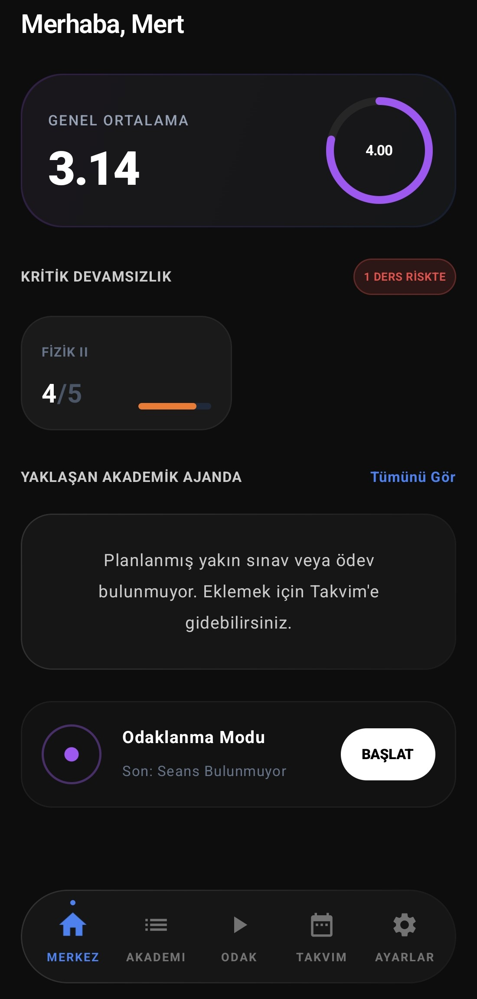
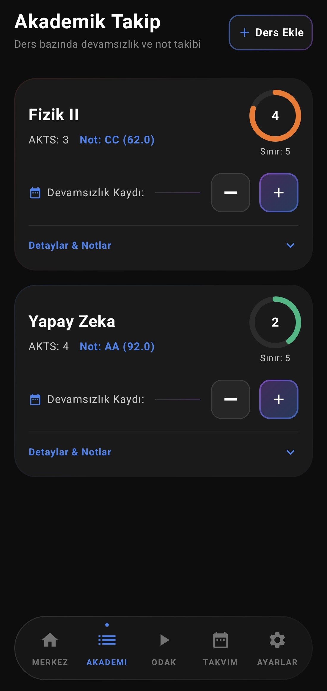
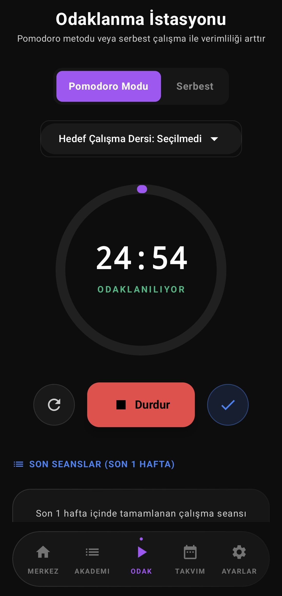
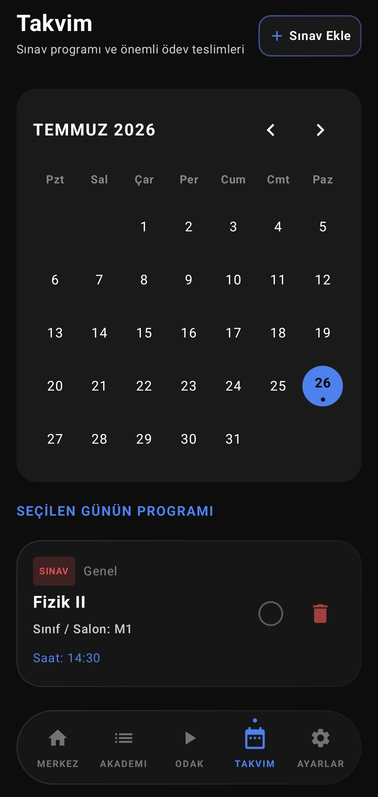
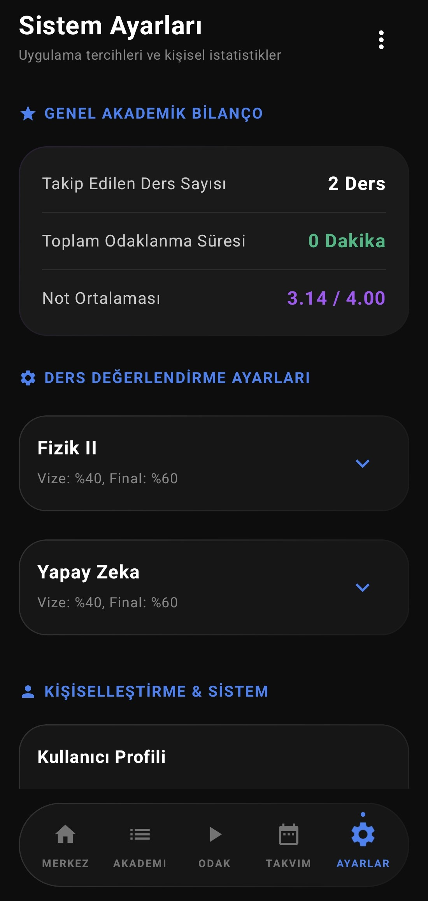
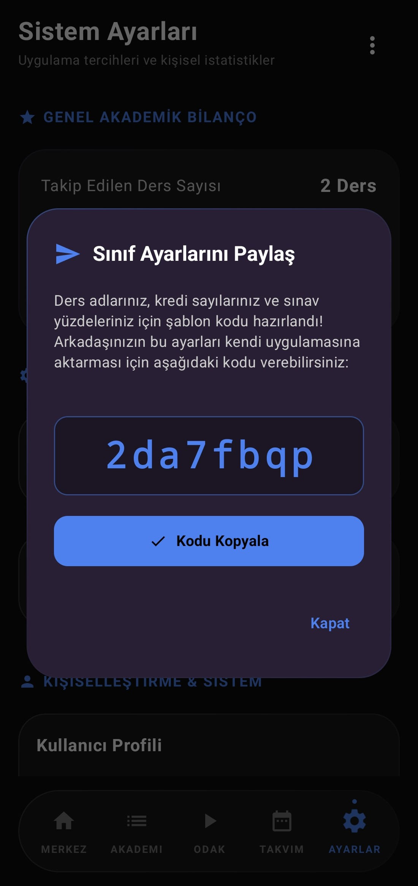

# Ganot

<p align="center">
  
</p>

<p align="center">
Üniversite öğrencileri için akıllı GANO hesaplama, devamsızlık ve sınav takip uygulaması.
</p>

<p align="center">
  
  
  
  
</p>

<p align="center">
 Developed by <a href="https://www.riestudio.com.tr">RieStudio</a>
</p>

---

# Genel Bakış

Ganot, üniversite öğrencilerinin akademik süreçlerini tek uygulama üzerinden yönetmesini sağlayan modern ve minimalist bir mobil asistandır.

Öğrenciler;

- GANO hesaplayabilir,
- Devamsızlıklarını takip edebilir,
- Vize, final ve bütünleme tarihlerini planlayabilir,
- Ders bilgilerini organize edebilir.

Tamamen hızlı, sade ve dikkat dağıtmayan bir kullanıcı deneyimi sunmayı hedefler.

---

# Ekran Görüntüleri

<p align="center">
  
  
  
  
  
  
</p>

---

# Özellikler

- 🎓 Akıllı GANO hesaplama
- 📅 Vize, final ve bütünleme takibi
- 📊 Devamsızlık yönetimi
- 📚 Ders planlama
- 🔔 Akademik hatırlatıcılar
- 🔒 Yerel ve güvenli veri saklama
- ⚡ Hızlı ve minimalist arayüz

---

# Mimari

- Kotlin Multiplatform (KMP)
- Compose Multiplatform
- MVVM Architecture
- Repository Pattern
- Offline First
- Şifrelenmiş yerel veri saklama

---

# Teknoloji Yığını

| Teknoloji | Amaç |
|-----------|------|
| Kotlin Multiplatform | Ortak iş mantığı |
| Compose Multiplatform | Kullanıcı arayüzü |
| Room / Local Database | Yerel veri saklama |
| Gradle | Derleme sistemi |

---

# Kurulum

Repoyu klonlayın.

```bash
git clone https://github.com/RieStudio/Ganot.git
```

Android Studio üzerinden projeyi açıp Android hedefini çalıştırabilirsiniz.

---

# Lisans

Bu Proje, [MIT Lisansı](LICENSE) kapsamında lisanslanmıştır.